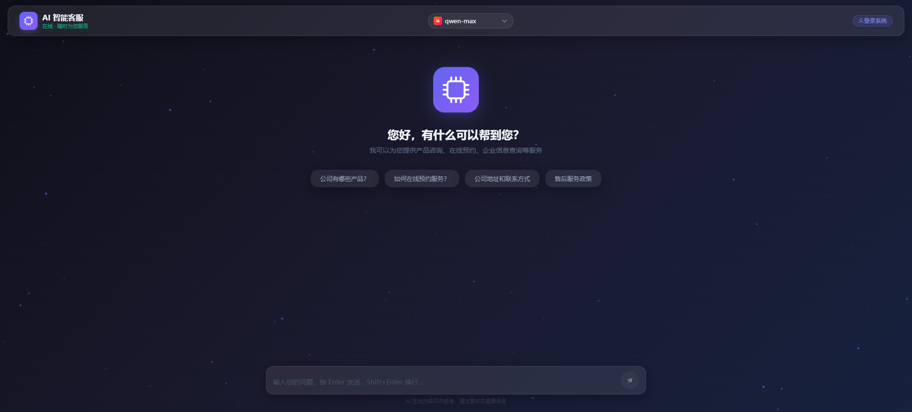
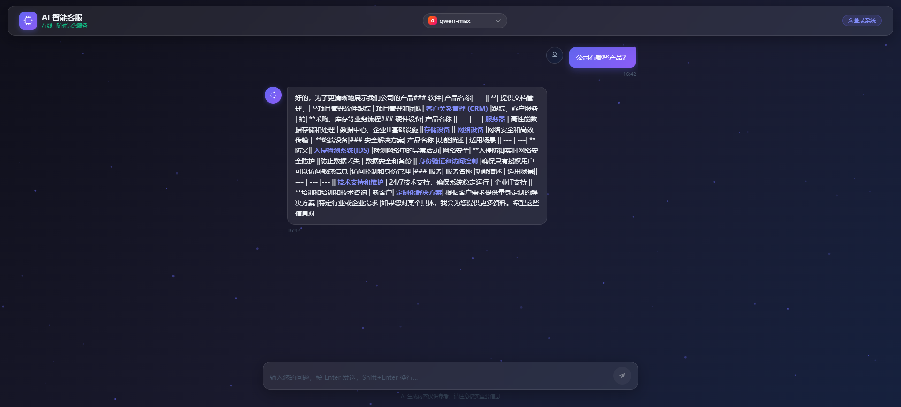
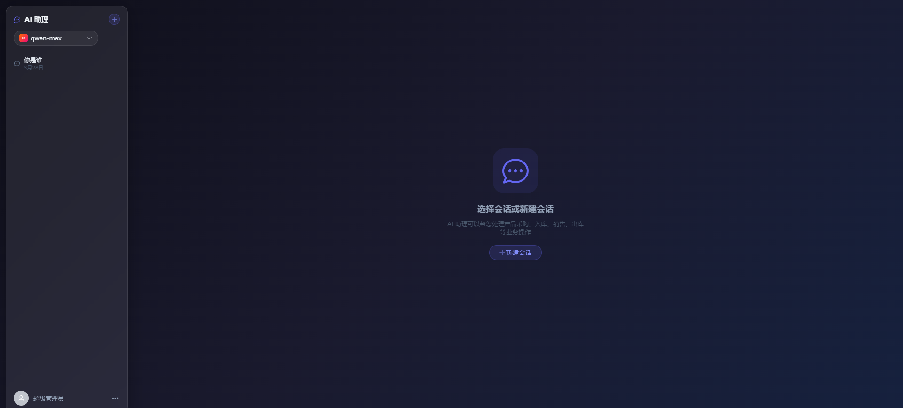
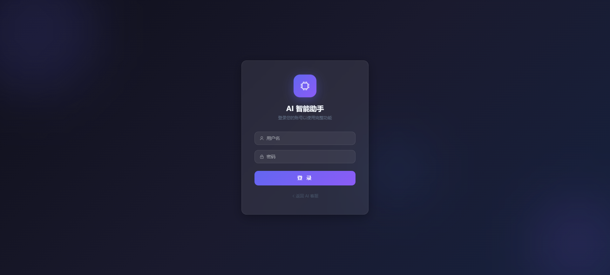
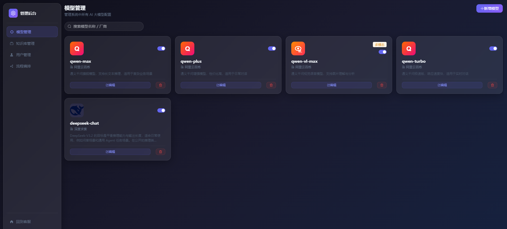
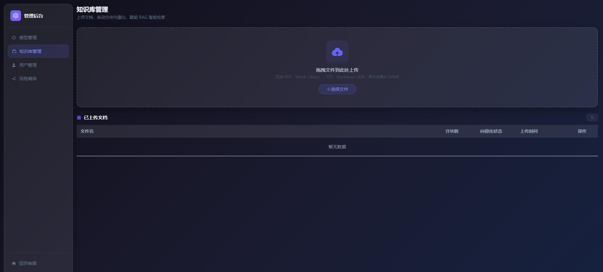
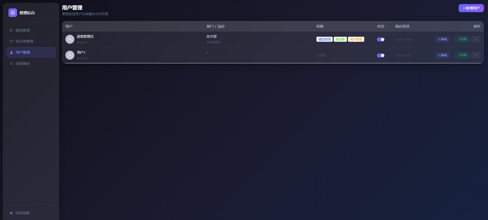
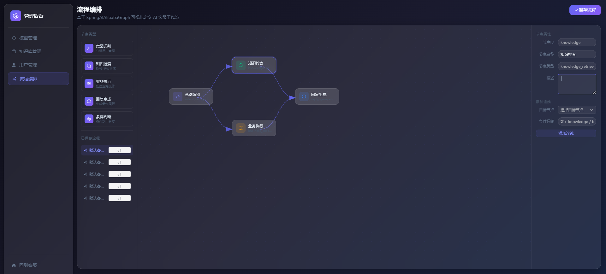

<div align="center">



# 🤖 AI 智能客服系统

**基于 Spring AI Alibaba + Vue3 的企业级全栈 AI 客服平台**

[](https://openjdk.org/)
[](https://spring.io/projects/spring-boot)
[](https://github.com/alibaba/spring-ai-alibaba)
[](https://vuejs.org/)
[](https://www.typescriptlang.org/)
[](LICENSE)

[演示截图](#-界面截图) · [快速开始](#-快速开始) · [技术栈](#-技术栈) · [部署指南](#-部署指南) · [项目结构](#-项目结构)

</div>

---

## ✨ 项目简介

**AI 智能客服系统**是一套开箱即用的企业级 AI 客服解决方案，集成了多模型动态切换、RAG 知识库检索、可视化流程编排等核心能力，帮助企业快速搭建专属 AI 客服。

### 🎯 核心特性

| 特性 | 说明 |
|------|------|
| 🗣️ **多模型动态切换** | 支持通义千问（qwen-max/plus/turbo）、DeepSeek 等兼容 OpenAI 协议的模型，管理后台热切换，无需重启 |
| 📚 **RAG 知识库** | 上传 PDF/Word/TXT/Markdown 文档，自动分块向量化，基于 Milvus 语义检索，回答精准可溯源 |
| 🔀 **可视化流程编排** | 基于 SpringAI AlibabaGraph，拖拽式定义意图识别 → 知识检索 → 业务执行 → 回复生成的完整工作流 |
| 💬 **流式对话** | SSE（Server-Sent Events）实时流式输出，支持 Markdown/代码高亮/表格完整渲染 |
| 🔐 **权限管理** | Sa-Token + JWT 双重认证，细粒度模块权限（模型管理 / 知识库 / 用户管理），前端密码 SHA256 哈希传输 |
| 🧠 **AI 记忆** | Redis 短期记忆（TTL 24h，最近 20 条）+ MySQL 长期持久化，跨会话记忆连贯 |
| 🧑‍💼 **AI 助手** | 独立 AI 对话助手界面，支持多会话管理，可用于企业内部员工辅助 |
| 🐳 **一键部署** | Docker Compose 编排全栈（MySQL / Redis / MinIO / Milvus / 后端 / Nginx），开箱即用 |

---

## 📸 界面截图

### 🏠 AI 客服首页
> 毛玻璃深色科技风，支持快捷问题引导，顶部模型实时切换


---

### 💬 客服聊天界面
> 流式输出、Markdown 表格渲染、代码高亮，完整的对话体验



---

### 🤖 AI 助手页面
> 多会话管理侧边栏，支持新建/切换会话，模型下拉选择



---

### 🔑 登录页面
> 毛玻璃卡片登录，前端 SHA256 + 盐值双重哈希密码传输



---

### ⚙️ 管理后台 - 模型管理
> 卡片式模型列表，支持新增/编辑/启用禁用，多标签（多模态）标记



---

### 📂 知识库管理
> 拖拽上传文档，自动分块向量化，实时展示向量化状态



---

### 👥 用户管理
> 用户列表与模块权限分配，支持新增用户、角色授权



---

### 🔀 流程编排
> 基于 SpringAI AlibabaGraph 的可视化节点编排，意图识别 → 知识检索/业务执行 → 回复生成



---

## 🛠️ 技术栈

### 后端

| 分类 | 技术 | 版本 | 说明 |
|------|------|------|------|
| **基础框架** | Spring Boot | 3.2.5 | 应用框架 |
| **响应式** | Spring WebFlux | 3.2.5 | SSE 流式推送 |
| **AI 框架** | Spring AI | 1.1.2 | AI 能力抽象层 |
| **AI Alibaba** | Spring AI Alibaba | 1.1.2.2 | 阿里云百炼 DashScope 集成 |
| **流程编排** | Spring AI Alibaba Graph | 1.1.2.2 | 可视化 AI 工作流编排 |
| **多模型** | Spring AI OpenAI | 1.1.2 | 兼容 OpenAI 协议（DeepSeek 等） |
| **持久化** | Spring Data JPA | 3.2.5 | ORM 框架 |
| **数据库** | MySQL | 8.0 | 主数据库 |
| **缓存** | Redis | 7.2 | AI 对话记忆 / Token 存储 |
| **向量数据库** | Milvus | 2.4.5 | RAG 知识库向量检索 |
| **对象存储** | MinIO | latest | 文档/文件存储 |
| **认证授权** | Sa-Token | 1.38.0 | 轻量级鉴权框架 |
| **JWT** | Sa-Token JWT | 1.38.0 | Token 生成与验证 |
| **工具库** | Hutool | 5.8.26 | Java 工具集 |
| **代码简化** | Lombok | 1.18.32 | 注解生成器 |
| **对象映射** | MapStruct | 1.5.5 | DTO ↔ Entity 映射 |
| **连接池** | HikariCP | 内置 | 数据库连接池 |
| **构建工具** | Maven | 3.x | 项目构建 |
| **运行环境** | Java | 17 | LTS 版本 |

### 前端

| 分类 | 技术 | 版本 | 说明 |
|------|------|------|------|
| **核心框架** | Vue.js | 3.4 | 渐进式前端框架（Composition API）|
| **类型系统** | TypeScript | 5.2 | 静态类型检查 |
| **UI 组件库** | Element Plus | 2.7 | 企业级组件库 |
| **状态管理** | Pinia | 2.1 | Vue 官方推荐状态管理 |
| **路由** | Vue Router | 4.3 | 客户端路由 |
| **HTTP 客户端** | Axios | 1.6 | 请求封装 |
| **Markdown 渲染** | marked | 12.0 | GFM 表格/代码块渲染 |
| **代码高亮** | highlight.js | 11.9 | 多语言代码高亮 |
| **加密** | crypto-js | 4.2 | 前端 SHA256 密码哈希 |
| **工具函数** | VueUse | 10.9 | Vue 组合式 API 工具集 |
| **进度条** | nprogress | 0.2 | 页面跳转进度条 |
| **构建工具** | Vite | 5.2 | 极速前端构建工具 |
| **CSS 预处理** | Sass | 1.75 | 样式预处理器 |
| **Web 服务器** | Nginx | alpine | 静态资源托管 + API 反向代理 |

### 基础设施

| 服务 | 说明 |
|------|------|
| **Docker Compose** | 全栈容器编排（6 个服务）|
| **etcd** | Milvus 元数据存储 |
| **MinIO** | 知识库文档 + 用户文件对象存储 |

---

## 🚀 快速开始

### 方式一：Docker Compose（推荐）

**前置条件**
- [Docker Desktop](https://www.docker.com/products/docker-desktop/) 已安装
- 阿里云百炼 API Key（[免费申请](https://dashscope.console.aliyun.com/apiKey)）

```bash
# 1. 克隆项目
git clone https://gitee.com/你的Gitee用户名/ai-customer.git
cd ai-customer

# 2. 配置环境变量
cp .env.example .env
# 编辑 .env，填写以下必填项：
#   DASHSCOPE_API_KEY=你的阿里云百炼API Key
#   JWT_SECRET_KEY=任意32位以上字符串

# 3. 一键启动（首次构建约需 5~10 分钟）
# Windows PowerShell：
.\deploy.ps1 start

# Linux / macOS：
docker compose up -d --build
```

启动成功后访问：

| 服务 | 地址 | 说明 |
|------|------|------|
| 🌐 **应用主页** | http://localhost | AI 客服前端 |
| 🔧 **后端 API** | http://localhost:8080 | REST API |
| 🗄️ **MinIO 控制台** | http://localhost:9001 | 对象存储管理 |

**默认账号**：`admin` / `admin123`

---

### 方式二：本地开发模式

> 适用于已有本地中间件（MySQL / Redis / MinIO / Milvus）的场景

**环境要求**

| 依赖 | 版本要求 |
|------|---------|
| Java | 17+ |
| Maven | 3.6+ |
| Node.js | 14+ |
| MySQL | 8.0+ |
| Redis | 6.0+ |
| Milvus | 2.4+ |
| MinIO | latest |

**第一步：初始化数据库**

```bash
mysql -u root -p < ai-customer-service-backend/src/main/resources/db/schema.sql
```

**第二步：配置后端**

编辑 `ai-customer-service-backend/src/main/resources/application.yml`：

```yaml
spring:
  datasource:
    password: 你的MySQL密码           # ← 必填

  ai:
    dashscope:
      api-key: sk-xxxxxxxxxxxx        # ← 必填，阿里云百炼 API Key

sa-token:
  jwt-secret-key: 任意32位以上字符串  # ← 必填
```

**第三步：启动后端**

```bash
cd ai-customer-service-backend
mvn spring-boot:run
# 看到 "Started AiCustomerServiceApplication" 表示启动成功
```

**第四步：启动前端**

```bash
cd ai-customer-service-frontend
npm install
npm run dev
# 访问 http://localhost:5173
```

---

## ⚙️ 环境变量说明

复制 `.env.example` 为 `.env` 并填写：

| 变量名 | 必填 | 默认值 | 说明 |
|--------|------|--------|------|
| `DASHSCOPE_API_KEY` | ✅ | 无 | 阿里云百炼 API Key，[前往申请](https://dashscope.console.aliyun.com/apiKey) |
| `JWT_SECRET_KEY` | ✅ | 内置默认值 | JWT 签名密钥，生产环境务必自定义（≥32 位）|
| `MYSQL_ROOT_PASSWORD` | ⚡ | `Aics@2026!` | MySQL root 密码 |
| `REDIS_PASSWORD` | ❌ | 空（无密码）| Redis 连接密码 |
| `MINIO_ACCESS_KEY` | ❌ | `minioadmin` | MinIO 访问密钥 |
| `MINIO_SECRET_KEY` | ❌ | `minioadmin` | MinIO 私有密钥 |
| `VITE_API_BASE_URL` | ❌ | `/api` | 前端 API 代理路径 |

---

## 📦 Docker 管理命令（Windows）

```powershell
.\deploy.ps1 start            # 启动所有服务
.\deploy.ps1 stop             # 停止所有服务
.\deploy.ps1 status           # 查看服务运行状态
.\deploy.ps1 logs backend     # 查看后端实时日志
.\deploy.ps1 logs frontend    # 查看前端实时日志
.\deploy.ps1 restart backend  # 重启后端（代码更新后）
.\deploy.ps1 clean            # ⚠️ 清除所有容器和数据（不可逆！）
```

---

## 📁 项目结构

```
ai-customer/
├── ai-customer-service-backend/          # Spring Boot 后端
│   ├── src/main/java/com/company/aics/
│   │   ├── controller/                   # REST API 接口层
│   │   │   ├── CustomerServiceController # 客服聊天接口（SSE 流式）
│   │   │   ├── AssistantController       # AI 助手接口（SSE 流式）
│   │   │   ├── KnowledgeController       # 知识库上传/查询接口
│   │   │   ├── AiModelController         # 模型管理 CRUD
│   │   │   ├── UserController            # 用户管理接口
│   │   │   └── WorkflowController        # 流程编排接口
│   │   ├── service/                      # 业务逻辑层
│   │   │   ├── ChatService               # 对话服务（Redis 记忆）
│   │   │   ├── AssistantService          # 助手服务
│   │   │   ├── KnowledgeService          # RAG 知识库服务
│   │   │   └── ChatClientFactory         # 多模型 ChatClient 工厂
│   │   ├── entity/                       # JPA 实体
│   │   ├── repository/                   # Spring Data JPA 仓库
│   │   ├── dto/                          # 请求/响应 DTO
│   │   ├── enums/                        # 业务枚举（ResultCode/MessageRole 等）
│   │   ├── graph/                        # SpringAI Graph 流程编排节点
│   │   └── config/                       # 配置类（CORS/Sa-Token/Milvus 等）
│   └── src/main/resources/
│       ├── application.yml               # 主配置文件
│       └── db/schema.sql                 # 数据库初始化脚本
│
├── ai-customer-service-frontend/         # Vue3 前端
│   ├── src/
│   │   ├── views/
│   │   │   ├── CustomerServiceView.vue   # AI 客服主页
│   │   │   ├── AssistantView.vue         # AI 助手页
│   │   │   ├── LoginView.vue             # 登录页
│   │   │   └── admin/
│   │   │       ├── ModelManagement.vue   # 模型管理
│   │   │       ├── KnowledgeManagement.vue # 知识库管理
│   │   │       ├── UserManagement.vue    # 用户管理
│   │   │       └── WorkflowManagement.vue # 流程编排
│   │   ├── components/
│   │   │   ├── ChatBubble.vue            # 对话气泡（marked 渲染）
│   │   │   └── ModelSelector.vue         # 模型下拉选择器
│   │   ├── stores/                       # Pinia 状态管理
│   │   ├── api/                          # Axios 请求封装
│   │   ├── utils/                        # SSE 工具、请求拦截器
│   │   └── styles/                       # 全局样式（毛玻璃深色主题）
│   ├── Dockerfile                        # 前端 Docker 构建文件
│   └── nginx.conf                        # Nginx 配置（含 SSE 长连接支持）
│
├── docs/
│   └── screenshots/                      # 项目截图
├── docker-compose.yml                    # Docker 全栈编排
├── deploy.ps1                            # Windows 一键部署脚本
├── .env.example                          # 环境变量模板
└── README.md
```

---

## 🔌 添加更多 AI 模型

系统支持所有兼容 OpenAI 协议的模型，在管理后台 **模型管理** 中添加：

| 模型服务商 | baseUrl | 说明 |
|------------|---------|------|
| 阿里云百炼（通义千问）| 留空 | 使用 DashScope 原生 SDK |
| DeepSeek | `https://api.deepseek.com` | deepseek-chat / deepseek-reasoner |
| OpenAI | `https://api.openai.com` | gpt-4o / gpt-4-turbo 等 |
| 本地 Ollama | `http://localhost:11434/v1` | llama3 / mistral 等本地模型 |
| 其他兼容服务 | 对应 API 地址 | 任意兼容 OpenAI `/v1/chat/completions` 的服务 |

---

## 🏗️ 系统架构

```
┌─────────────────────────────────────────────────────────────┐
│                        前端 (Nginx)                          │
│  Vue3 + TypeScript + Element Plus + Pinia                    │
│  ┌──────────┐ ┌──────────┐ ┌──────────┐ ┌──────────────┐  │
│  │ AI客服页  │ │ AI助手页  │ │ 登录/权限 │ │  管理后台    │  │
│  └──────────┘ └──────────┘ └──────────┘ └──────────────┘  │
└─────────────────────────┬───────────────────────────────────┘
                          │ HTTP / SSE
┌─────────────────────────▼───────────────────────────────────┐
│                    后端 (Spring Boot 3)                       │
│                                                              │
│  ┌─────────────┐  ┌──────────────┐  ┌───────────────────┐  │
│  │ 鉴权层       │  │ 业务层        │  │  流程编排层        │  │
│  │ Sa-Token+JWT │  │ Chat/Assistant│  │  Graph 节点调度   │  │
│  └─────────────┘  └──────────────┘  └───────────────────┘  │
│                                                              │
│  ┌──────────────────────────────────────────────────────┐   │
│  │              ChatClientFactory（多模型路由）           │   │
│  │  DashScope（qwen-*）  /  OpenAI 协议（DeepSeek 等）   │   │
│  └──────────────────────────────────────────────────────┘   │
└──────────────┬────────────────────────────────────────────  ┘
               │
    ┌──────────┼──────────────────────────┐
    ▼          ▼           ▼              ▼
┌────────┐ ┌───────┐  ┌────────┐   ┌──────────┐
│ MySQL  │ │ Redis │  │ Milvus │   │  MinIO   │
│ 持久化  │ │ 对话  │  │ 向量   │   │ 文件存储 │
│        │ │ 记忆  │  │ 检索   │   │          │
└────────┘ └───────┘  └────────┘   └──────────┘
```

---

## 🔒 安全设计

- **密码双重哈希**：前端 `SHA256(salt + password)` → 后端 `BCrypt(clientHash)` 存储，传输和存储均不含明文
- **JWT 无状态认证**：Sa-Token 生成 JWT，Redis 存储 Token 状态，支持主动注销
- **跨域防护**：后端 `CorsFilter` 严格配置允许来源，非配置来源一律拒绝
- **权限粒度控制**：模型管理 / 知识库 / 用户管理 三模块独立权限，按需授予
- **参数校验**：全局 `@Valid` + 自定义 `GlobalExceptionHandler`，拒绝非法请求

---

## 🤝 贡献指南

欢迎提交 Issue 和 Pull Request！

1. Fork 本仓库
2. 创建特性分支：`git checkout -b feature/your-feature`
3. 提交改动：`git commit -m "feat: 添加xxx功能"`
4. 推送分支：`git push origin feature/your-feature`
5. 提交 Pull Request

---

## 📄 开源协议

本项目基于 [MIT License](LICENSE) 开源，欢迎用于商业和非商业项目。

---

## 🙏 致谢

- [Spring AI Alibaba](https://github.com/alibaba/spring-ai-alibaba) - 阿里云 AI 框架
- [Spring AI](https://spring.io/projects/spring-ai) - Spring AI 核心框架
- [Element Plus](https://element-plus.org/) - Vue3 UI 组件库
- [Milvus](https://milvus.io/) - 高性能向量数据库
- [Sa-Token](https://sa-token.cc/) - 轻量级 Java 权限认证框架

---

<div align="center">

如果这个项目对你有帮助，欢迎 ⭐ Star 支持！

</div>
